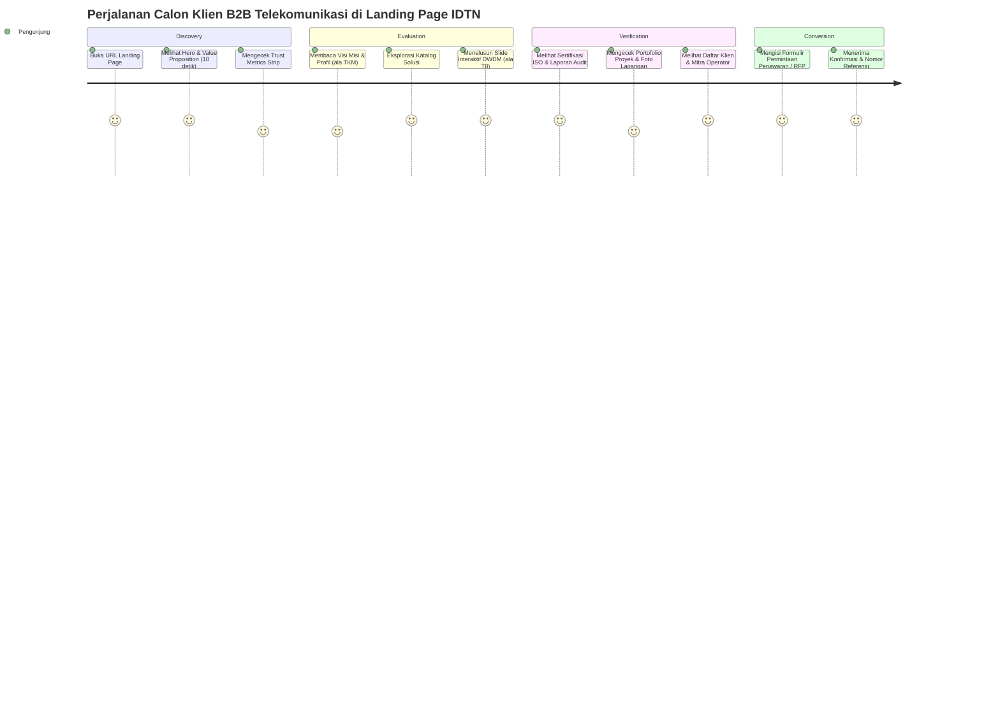
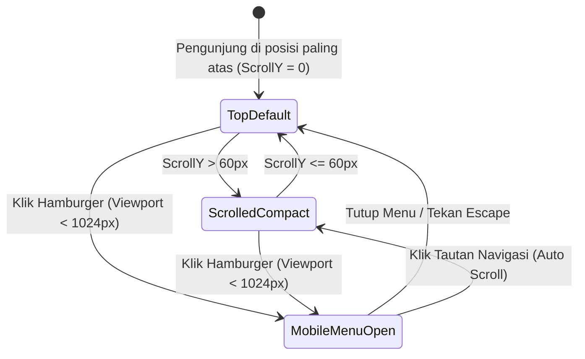
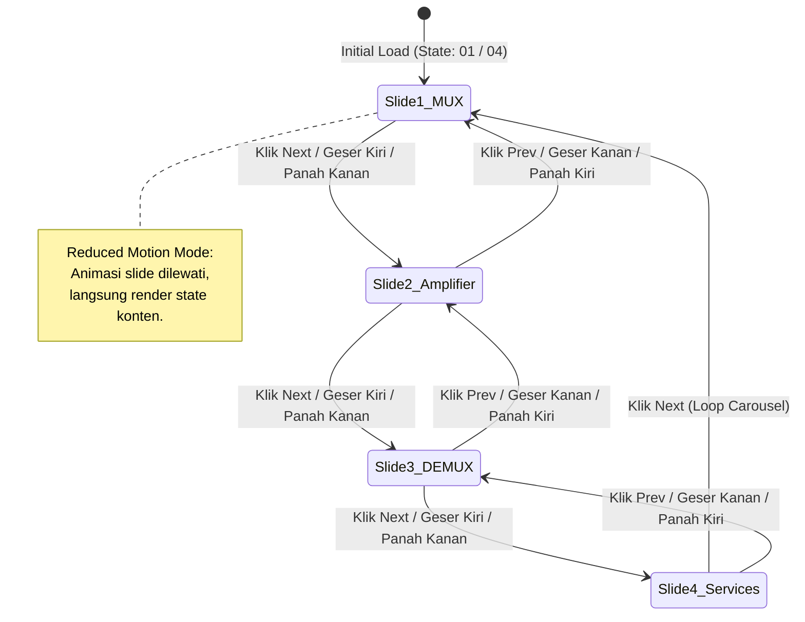
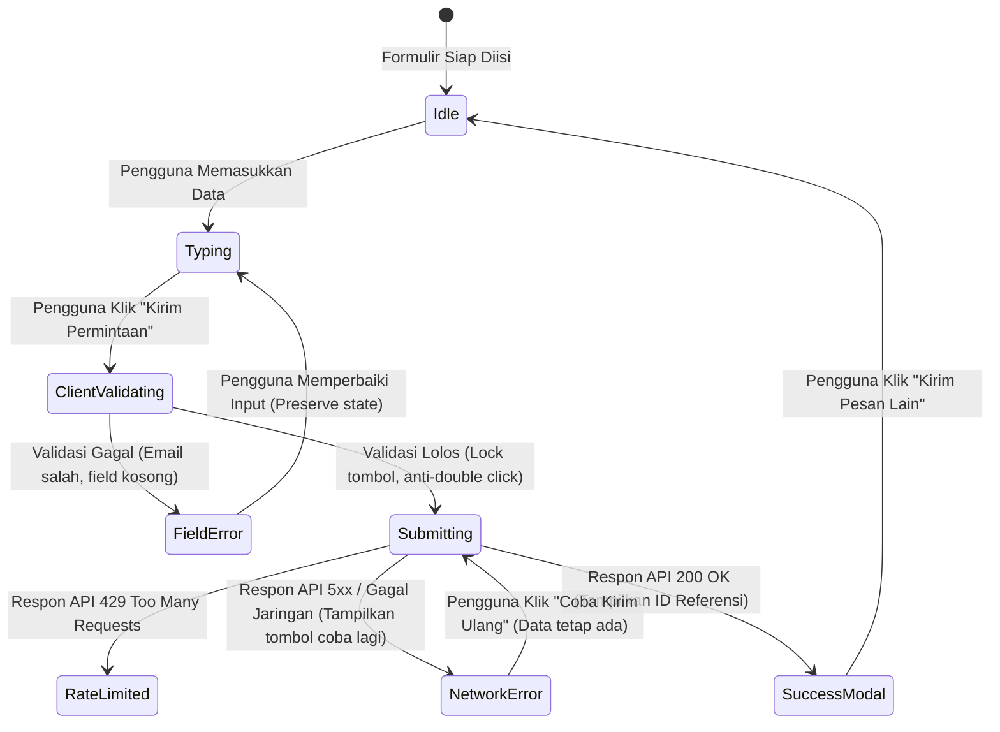

# App Flow Documentation (AFD) — IDTN Landing Page
**ID Dokumen:** IDTN-WEB-AFD-003  
**Versi:** 2.0.0 (SDLC Multi-Role Audit Standard)  
**Status:** Approved for Implementation  
**Klasifikasi:** Interaction & State Architecture  

---

## 1. Overview & Flow Principles

Dokumen ini memetakan seluruh interaksi pengguna (*user journeys*), siklus hidup *state*, transisi antar section, serta mekanisme penanganan kegagalan (*edge cases*) pada landing page IDTN.

Prinsip Utama Alur Interaksi:
1. **Zero Friction Navigation**: Pengunjung dapat berpindah ke informasi inti tanpa harus melewati rintangan interaksi yang rumit.
2. **Deterministic State Transition**: Setiap animasi dan transisi slide memiliki *state* yang dapat diprediksi secara matematis.
3. **Graceful Error Recovery**: Setiap kegagalan jaringan atau input yang salah memberikan panduan perbaikan yang jelas tanpa menghapus isian pengguna.

---

## 2. User Journey Maps

---

## 3. State Transition Diagrams

### 3.1 Siklus Hidup Header Sticky

### 3.2 Siklus Slide Interaktif DWDM & Peralatan (ala T8.ru)

### 3.3 Siklus Hidup Formulir Inquiry B2B

---

## 4. Mekanisme Detail Interaksi Slide ala T8.ru

Section DWDM Explorer dan Portofolio Proyek mengadopsi pola *PowerPoint-like Slide Deck* dengan rincian teknis sebagai berikut:

### 4.1 Kontrol Navigasi
1. **Tombol Navigasi Visual**: Tombol panah kiri (*Previous*) dan kanan (*Next*) berukuran `44x44px` (memenuhi standar target sentuh WCAG 2.2).
2. **Indikator Progres Numerik**: Menampilkan penomoran dinamis dalam format `XX / Total` (contoh: `01 / 04`, `02 / 04`) yang berubah secara sinkron dengan perpindahan slide.
3. **Gesture Sentuh (Touch / Swipe)**:
   - Threshold sapuan: `50px` jarak minimum usapan horizontal.
   - Deteksi kecepatan: Usapan cepat (*flick*) berpindah 1 slide terdekat.
   - Hambatan vertikal: Sapuan diagonal tidak menghambat scroll vertikal halaman (menggunakan CSS `touch-action: pan-y`).
4. **Navigasi Keyboard**:
   - Saat container slide mendapatkan fokus (`:focus-within`), tombol panah kiri (`ArrowLeft`) memicu slide sebelumnya dan panah kanan (`ArrowRight`) memicu slide berikutnya.
   - Tombol `Home` kembali ke slide 1, tombol `End` lompat ke slide terakhir.

### 4.2 Accessibility & Fallback
- Setiap kartu slide memiliki atribut `aria-roledescription="slide"` dan `aria-label="Slide X dari Total"`.
- Jika JavaScript gagal dimuat, container slide bertransisi otomatis ke layout flex vertikal (*stacked list*) sehingga seluruh konten tetap dapat dibaca secara utuh.

---

## 5. Alur Modal Sertifikasi & Laporan Audit (ala TKM)

1. **Pemicu (Trigger)**: Pengguna mengklik tombol "Lihat Dokumen Legalitas" atau "Ringkasan Audit" pada kartu sertifikat.
2. **Aktivasi Modal**:
   - Scrollbar halaman utama dikunci (`overflow: hidden` pada `<body>`).
   - Fokus keyboard langsung dipindahkan ke judul modal (`aria-labelledby`).
   - *Focus Trap* aktif di dalam modal (menekan `Tab` berulang hanya berpindah di antara elemen interaktif di dalam modal).
3. **Penutupan Modal**:
   - Menekan tombol `Escape`.
   - Mengklik tombol silang penutup (`aria-label="Tutup jendela"`).
   - Mengklik area *backdrop* luar modal.
   - Saat tertutup, fokus keyboard dikembalikan ke tombol pemicu semula (*restore focus*).

---

## 6. Penanganan Edge Cases & Failure Recovery

| Skenario Kegagalan | Dampak | Mekanisme Mitigasi & Pemulihan |
| :--- | :--- | :--- |
| **Koneksi Terputus (Offline)** | Formulir tidak dapat dikirim | Banner info offline muncul di bagian atas formulir; isian pengguna tetap tersimpan di memori; tombol submit menampilkan pesan "Menunggu koneksi internet...". |
| **Jaringan Sangat Lambat (Slow 3G)** | Aset gambar galeri lambat tampil | Menampilkan *blur-up placeholder* atau skeleton loading dengan rasio dimensi tetap (`aspect-ratio: 16/9`) untuk mencegah layout shifting (CLS). |
| **JavaScript Dimatikan / Gagal** | Animasi dan slider tidak berfungsi | CSS Native Fallback: Slider berubah menjadi layout grid statis; tombol CTA telepon/email langsung membuka URI protokol native (`tel:+6221...` dan `mailto:...`). |
| **Submission Spam oleh Bot** | Beban server & inbox spam | Field honeypot `_gotcha` yang tersembunyi secara visual. Jika field ini terisi saat form disubmit, respon sukses palsu diberikan tanpa memproses payload ke backend (*silent drop*). |
| **Pengguna Mengklik Submit Berkali-kali** | Duplikasi tiket inquiry | State tombol submit langsung berubah menjadi disabled dengan animasi spinner seketika pada klik pertama. |
